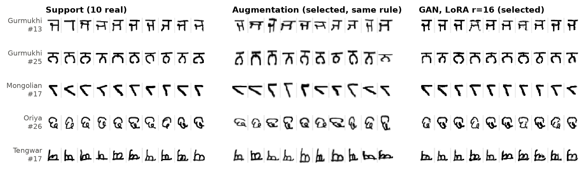

# fewshot-glyph-gan

Adapting a small, fixed-architecture GAN to a new handwritten symbol from 10 drawings.

The generator is a 1.5M-parameter MLP whose architecture comes from a course project and stays fixed. I pretrain it
as a WGAN-GP on the 964 Omniglot background characters, then adapt it to each unseen character from 10 examples. At
equal novelty, the adapted generator is clearly more faithful than a tuned augmentation baseline.

Test set: 314 characters from 10 alphabets never used for training. Each configuration was selected on a separate dev
set with the same rule, fixed before any test run (see Protocol). 95% CIs from a paired bootstrap over characters.

| Method (10 drawings in) | Objective | Precision | Coverage | Identity | copy_feat |
|---|---|---|---|---|---|
| GAN + LoRA r=16 (selected) | 0.755 [0.738, 0.771] | 0.735 | 0.775 | 0.874 | 0.95 |
| GAN, full fine-tuning | 0.746 [0.730, 0.762] | 0.719 | 0.775 | 0.863 | 0.96 |
| GAN + LoRA r=1 (4.5k params) | 0.730 [0.712, 0.747] | 0.724 | 0.736 | 0.866 | 0.96 |
| Augmentation, same rule | 0.589 [0.569, 0.609] | 0.581 | 0.597 | 0.854 | 0.93 |
| *Ref.* augmentation without the novelty rule | 0.791 | 0.793 | 0.789 | 0.906 | 0.59 |
| *Ref.* returning the 10 support drawings | 0.882 | 0.855 | 0.911 | 0.915 | 0 |

Precision / coverage are computed against the 10 held-out drawings of the character in a learned feature space, and
the objective is their harmonic mean. Identity: is the sample closest to the right character within its alphabet.
copy_feat: distance to the support relative to the spread of the support (fresh human drawings ≈ 1, copies = 0).

GAN − augmentation (paired): objective +0.166 [+0.151, +0.181], identity +0.019 [+0.009, +0.030]. A LoRA adapter of
71k parameters per symbol (about 140 KB in fp16) is as good as full fine-tuning.

Note on the baseline: after the first test run, re-reading the evaluation code showed that the augmentation search had
been refined under a pixel-space copy constraint instead of the feature-space one used by the rule. I ran a second
search on dev (85 configurations) under the right constraint and replayed its pick once on test: the baseline went
from 0.542 to 0.589, and the table uses this stronger number.

## Background

The starting point is a course project (in [`mnist/`](mnist/)): improve an MNIST generator without changing its
architecture (MLP 100-256-512-1024-784). I ended up with a WGAN, model selection by validation FID, and critic-guided
latent refinement at inference time, which placed 5th out of 50 groups in the course challenge. The follow-up question: if a generator this small is cheap to store and run, can
it be adapted to a new symbol from a handful of examples, the way LoRA adapts large models?

## Protocol

- Data: Omniglot at 28×28, glyph cropped on its ink bounding box and centred (MNIST-style). Background alphabets (964
  characters) are used for pretraining only. The 20 evaluation alphabets are split by alphabet into dev (345
  characters, all tuning) and test (314 characters, final numbers only).
- Episode: for each new character, 10 of its 20 drawings are the support (the only images the method sees), the other
  10 are held out for the metrics.
- Metrics, in the feature space of a classifier trained on the background characters: precision and coverage
  (Kynkäänniemi et al. 2019, Naeem et al. 2020), identity, and the feature copy ratio copy_feat (nearest-neighbour
  distance from samples to the support, divided by the leave-one-out distance within the support).
- Why novelty has to be measured: on dev, simply returning the 10 support drawings scores 0.85 on the objective, close
  to the 0.89 of fresh real drawings. With 10 vs 10 images these metrics reward copying, so I compare methods on a
  fidelity–novelty frontier and select with one rule for all methods: maximise the dev objective subject to
  copy_feat ≥ 0.9, then run the selected configuration once on test.

## Method

1. Pretraining (`scripts/pretrain.py`): WGAN-GP (λ = 10) with a CNN critic (only the generator is constrained), small
   drift penalty, EMA of the generator weights. Checkpoint chosen by background FID.
2. Adaptation (`scripts/adapt.py`): WGAN-GP between the 10 support images and the generator, starting from the
   pretrained generator and critic. Generator side: full fine-tuning or LoRA (`W + (α/r)·B·A`, B = 0 at init, merged
   afterwards so the deployed model keeps the original architecture). Critic side: DiffAugment translations (Zhao et
   al. 2020) and the two lower conv blocks frozen (FreezeD, Mo et al. 2020). Without DiffAugment the critic memorises
   the 10 images and the generator ends up copying them.
3. Critic-guided refinement at sampling time (from the MNIST project): `z ← z + η·∇z C(G(z)) / ‖∇z C(G(z))‖`.
4. Batched adaptation (`glyphgan/batched.py`): K characters are adapted at once on one GPU. Base weights are shared
   (one matmul), LoRA factors are per character (bmm), the K critics are grouped convolutions, and frozen critic layers
   run once for all K. Summing the K losses gives each character exactly its own gradient, so this is equivalent to K
   separate runs (checked in `tests/test_batched.py`). 345 characters × 3000 steps take about 22 min on one GPU.

## Results


*Test split. Each GAN line is one run seen at increasing adaptation steps (more steps: more faithful, less novel).
Diamonds: with critic-guided refinement. Grey: dev Pareto frontier of the first augmentation search, replayed on test.
Stars: configurations picked by the rule on dev (the augmentation star comes from the second search).*



*Test characters: the 10 support drawings, augmentation selected by the same rule, and the adapted generator (LoRA
r=16). To be as novel, augmentation has to distort the glyph.*

### Other experiments

On dev (345 characters) unless stated:

| Change | Effect |
|---|---|
| No DiffAugment | objective 0.607 → 0.554 (LoRA r=4); critic score gap support − held-out 1.9 → 7.6 |
| Critic-guided refinement | +0.087 on test (full FT, 0.659 → 0.746), copy_feat −0.10 |
| Critic filtering (keep best 50% of 200) | 0.759 at copy_feat 0.95, below refinement (0.772), so not selected |
| Truncation ψ = 0.7 | more novel, less faithful, never selected |
| FreezeD (2 blocks) | same quality, about 2× faster |
| LoRA lr 3e-3 | fine on an early checkpoint, mode collapse on the final one (recall 0.2); 1e-4 to 3e-4 works |
| LoRA rank 1 / 4 / 16 / 64 | 0.759 / 0.761 / 0.772 / 0.747 |
| Better prior (pretraining 10k / 30k / 80k steps) | 0.662 / 0.669 / 0.676 on 128 dev characters |
| Prior only (invert the 10 drawings, sample around them) | best 0.586 at copy_feat 0.82; with noise σ ≥ 0.1 samples drift to other characters |

## Limitations

- 28×28 and an MLP generator: samples are blurrier than real drawings (precision 0.74 vs 0.86 for the support itself).
  The native 105×105 resolution would make the output layer 14× larger, mostly for empty pixels.
- All metrics live in one feature space. Identity is only a partial cross-check.
- The 0.9 novelty threshold is a choice. The full frontier is shown: the GAN stays above augmentation for copy_feat
  above about 0.65; below that, shifted copies of the support are hard to beat.
- The baseline fix described above came after the first test run (search on dev, one replay on test).
- Seeds: three adaptation seeds of the selected configuration give 0.755 / 0.755 / 0.753 on test; other
  configurations have one seed. On dev, LoRA r=16 (0.7724) vs full fine-tuning (0.7720) is a tie broken by the rule.

## Demo

Draw a symbol a few times and click Generate: the generator is adapted to it with the selected configuration (about
20 s on an Apple-silicon GPU, about 3 min on CPU) and new samples are shown.

```bash
uv sync --extra demo
uv run python -m scripts.demo        # needs checkpoints/gp_b_200k.pt
```

Before adaptation, each drawing is cropped, rescaled to the median Omniglot glyph size, thinned and re-thickened to
the Omniglot stroke width, then goes through the training preprocessing (`glyphgan/drawing.py`), so position, size and
brush width on the canvas don't matter.

## Reproduce

```bash
uv sync
python -m glyphgan.data --root data          # downloads Omniglot, builds data/omniglot28c.pt
python -m scripts.train_features             # feature extractor for the metrics
python -m scripts.pretrain --run gp_b --steps 200000 --lr_g 2e-4 --lr_c 2e-4 --beta1 0.5
python -m scripts.select_pretrain runs/pretrain/gp_b
python -m scripts.adapt --ckpt runs/pretrain/gp_b/ckpt_200000.pt --r 16 --lr_g 1e-4 --chunk 345 \
       --part dev --steps 3000 --eval_steps 250,500,1000,1500,2000,3000 --run g3_lora16_lr1e-4
python -m scripts.eval_pools runs/adapt/g3_lora16_lr1e-4
python -m scripts.select_rule runs/adapt/g* --out runs/select_dev.json
python -m scripts.headline GAN=runs/adapt/t3_lora16_lr1e-4/eval_1500_r10x0.1.json AUG=runs/adapt/aug_feat09v2_test/eval_0.json
```

Code: `glyphgan/` (data, models and LoRA, batched adaptation, metrics, augmentation baseline, demo helpers),
`scripts/` (entry points), `tests/`, and `mnist/` for the original project.
