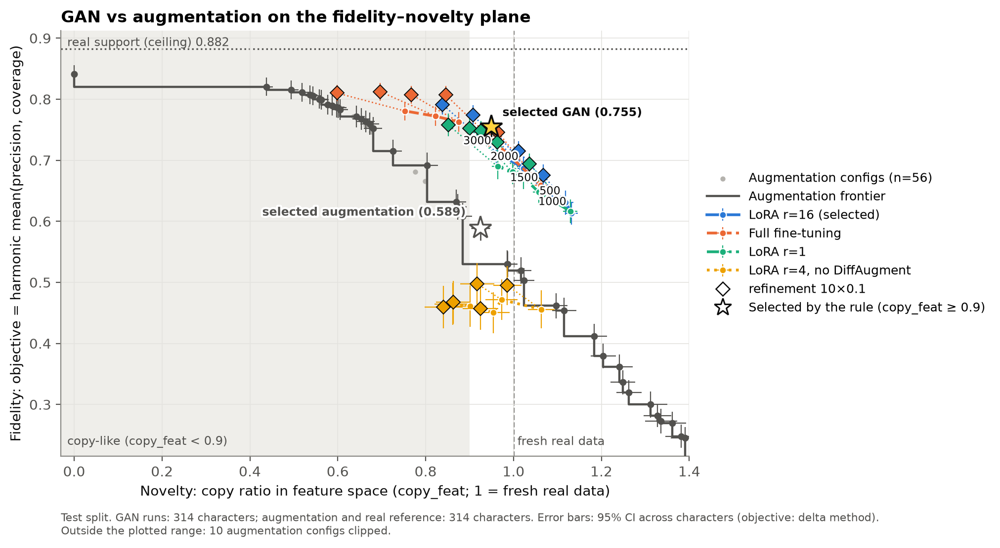

# fewshot-glyph-gan

**Teach a tiny, fixed-capacity GAN a brand-new handwritten symbol from 10 drawings.**

A 1.5M-parameter MLP generator (architecture imposed, never modified) is pretrained as a WGAN-GP on 964 Omniglot
characters, then adapted to each *unseen* character from only 10 examples. Adapted generators produce drawings that are
**as novel as fresh human drawings while staying recognisable**, a regime where the strongest hand-tuned augmentation
baseline cannot follow.

**Test set: 314 characters from 10 alphabets never seen in training. Each method's configuration was selected on a
separate dev set by one rule fixed in advance (see Protocol). 95% CIs from a paired bootstrap over characters.**

| Method (10 drawings in) | Objective ↑ | Precision ↑ | Coverage ↑ | Identity ↑ | Novelty (copy_feat, 1 = fresh data) |
|---|---|---|---|---|---|
| **GAN + LoRA r=16 adapter** (selected) | **0.755** [0.738, 0.771] | 0.735 | 0.775 | **0.874** | 0.95 |
| GAN, full fine-tuning | 0.746 [0.730, 0.762] | 0.719 | 0.775 | 0.863 | 0.96 |
| GAN + LoRA r=1 adapter (4.5k params, 9 KB) | 0.730 [0.712, 0.747] | 0.724 | 0.736 | 0.866 | 0.96 |
| Hand-tuned augmentation, same selection rule | 0.589 [0.569, 0.609] | 0.581 | 0.597 | 0.854 | 0.93 |
| *Reference:* augmentation tuned without the novelty rule | 0.791 | 0.793 | 0.789 | 0.906 | **0.59** (shifted copies) |
| *Reference:* the 10 real drawings themselves | 0.882 | 0.855 | 0.911 | 0.915 | 0 (they *are* the support) |

*Precision / coverage*: generated samples vs the 10 held-out drawings of the character, in a learned feature space;
*objective* = their harmonic mean; *identity* = sample closest to the right character among its alphabet;
*copy_feat* = distance to the support relative to the spread of the support (fresh human drawings ≈ 1, copies = 0).

**GAN − augmentation, paired: objective +0.166 [+0.151, +0.181], identity +0.019 [+0.009, +0.030].** At equal novelty the
adapted generator is far more faithful than any augmentation we could tune, and a per-symbol adapter of 71k parameters
(4.8% of the generator, about 140 KB in fp16) matches full fine-tuning.

*Fairness note.* An independent audit found the augmentation search had been refined under a pixel-space copy
constraint instead of the feature-space one used by the rule; a second search (85 more configurations) under the
correct constraint raised the baseline from 0.542 to 0.589 on test. The table reports the stronger baseline.

## Where this comes from

The starting point was a course project (kept in [`mnist/`](mnist/)): improve an MNIST generator **without touching its
architecture** (MLP 100-256-512-1024-784). Within that fixed budget we moved from a vanilla GAN to a WGAN, selected models
by validation FID, and added *critic-guided latent refinement* at inference time. Working under a hard capacity
constraint raised a product question: if a small generator is cheap to store and to run, can it be **personalised to a
new symbol** (a logo, a rare glyph, a user's own handwriting) from a handful of examples, the way LoRA personalises large
models?

## Problem and protocol

- **Data.** Omniglot at 28×28, glyph cropped on its ink bounding box and centred (MNIST-style). *Background* alphabets
  (30 alphabets, 964 characters, 19,280 images) are used for pretraining only. *Evaluation* alphabets (20 alphabets,
  659 characters) are never seen before adaptation and are split by alphabet into **dev** (345 characters, all tuning)
  and **test** (314 characters, final numbers only).
- **Episode.** For each new character, its 20 drawings are split into 10 *support* images (the only ones the method sees)
  and 10 *held-out* images (metrics only).
- **Metrics**, in the feature space of a classifier trained on background characters, averaged over characters with
  95% t-intervals:
  - *fidelity*: precision and coverage of the generated samples against the held-out drawings (Kynkäänniemi 2019,
    Naeem 2020); their harmonic mean is the **objective**;
  - *identity*: is a sample closest to the right character among all characters of its alphabet;
  - *novelty*: **feature copy ratio**, the nearest-neighbour distance from generated samples to the support divided by
    the leave-one-out distance within the support. Fresh human drawings score ≈ 1.0; copies score 0.
- **Why novelty must be measured.** With 10 real drawings in hand, simply *returning them* already scores 0.85 on the
  objective (real-data reference 0.89): distribution metrics reward copying. Generation is only useful if it adds new,
  faithful drawings, so methods are compared on the **fidelity–novelty frontier**, and the headline number uses a rule
  fixed *before* looking at test: **maximise the dev objective subject to feature copy ratio ≥ 0.9**, the same rule for
  every method, then replay the selected configuration once on test.

## Method

1. **Pretraining** (`scripts/pretrain.py`). WGAN-GP (λ = 10) with a CNN critic (only the generator is constrained),
   drift penalty, EMA of the generator weights; checkpoint selected by background FID.
2. **Few-shot adaptation** (`scripts/adapt.py`). For each new character, WGAN-GP between its 10 support images and the
   generator, starting from the pretrained generator *and* critic:
   - **generator side**: full fine-tuning, or **LoRA** adapters `W + (α/r)·B·A` (B = 0 at init, so adaptation starts
     exactly at the prior). Merged afterwards, so the deployed generator keeps the original architecture; only `A, B`
     are stored per symbol;
   - **critic side**: DiffAugment translation on real and fake (Zhao 2020) and FreezeD (Mo 2020, lower conv blocks
     frozen). Without DiffAugment the critic memorises the 10 images (its score gap support vs held-out grows 3–4×) and
     the generator follows it into copying.
3. **Inference-time critic refinement** (inherited from the MNIST project): each latent is moved along the normalised
   gradient of the *adapted* critic, `z ← z + η·∇z C(G(z))/‖∇z C(G(z))‖`. No weight changes; one extra point on the
   frontier.
4. **Batched adaptation** (`glyphgan/batched.py`). K characters are adapted *simultaneously* on one GPU, as one
   computation: shared frozen base weights (one matmul), per-character LoRA factors (bmm), K critic copies as grouped
   convolutions, with frozen critic layers computed once for all K. The loss is the sum of the K per-character losses,
   so each character gets exactly its own gradient (Adam is element-wise): mathematically identical to K separate runs,
   verified in `tests/test_batched.py`. 345 characters × 3000 steps take about 22 minutes on one 20 GB GPU: the
   selected 1500-step adaptation costs **about 2 s of GPU time per new symbol**, amortised.

## Results



*Test split. Each GAN line is one adaptation run seen at increasing steps (longer adaptation: more faithful, less novel).
Diamonds: same generator with critic-guided latent refinement. Grey: the dev Pareto frontier of the first augmentation
search, replayed on test. Left of 0.9 the samples are essentially copies of the support. Stars: the configurations
picked by the rule on dev. The augmentation star comes from the second, correctly constrained search (see the fairness
note), which is why it sits above the grey frontier.*


*Test characters: the 10 support drawings, the augmentation selected by the same novelty rule, and the adapted generator
(LoRA r=16). At equal novelty, augmentation has to distort the glyph; the generator produces new, clean variants.*

**Is a better prior a better few-shot learner?** Adapting from successive pretraining checkpoints (10k / 30k / 80k
steps) improves the objective monotonically but modestly (0.662 → 0.669 → 0.676 on 128 dev characters): most of the
gain comes from adaptation itself.

## Baselines and ablations

All on dev (345 characters) unless stated.

| Change | Effect |
|---|---|
| No DiffAugment on the critic | objective 0.607 → 0.554 (LoRA r=4); critic score gap support − held-out at step 500: 1.9 → 7.6: the critic memorises the 10 images and the generator follows it into copying |
| Critic-guided latent refinement (inference only) | +0.087 objective on test (full FT, 0.659 → 0.746), at the cost of −0.10 novelty |
| Critic rejection sampling (keep best 50%) | +0.05 objective with *more* novelty than refinement (0.759 at copy_feat 0.95), but not selected by the rule |
| Truncation ψ = 0.7 | more novel but less faithful and less recognisable with this generator: never selected |
| FreezeD (freeze 2 lower critic blocks) | same quality as no freezing, 2× faster: kept |
| LoRA learning rate 3e-3 (fine on an early checkpoint) | mode collapse on the final checkpoint (recall 0.2); 1e-4 to 3e-4 required. Not caused by batching (control run with 128 characters) |
| LoRA rank r = 1 / 4 / 16 / 64 | 0.759 / 0.761 / **0.772** / 0.747 under the rule: rank matters little once the learning rate is right |
| **Prior only**: invert the 10 drawings into the frozen generator's latent space, sample around them | best objective 0.586 at copy_feat 0.82 (near-copies); any noise σ ≥ 0.1 drifts to other characters (identity 0.72). **Adapting the weights is necessary** |

## Limitations

- **28×28, binary-ish strokes, an MLP generator.** Samples are visibly blurrier than real drawings (precision 0.74 vs 0.86
  for real data). Moving to the native 105×105 resolution would multiply the output layer by 14 for mostly empty pixels
  and break the fixed-capacity premise.
- **Metrics live in one feature space** (a classifier trained on the background alphabets). All methods are measured in
  the same space, but a single embedding can be gamed; identity accuracy is a partial
  cross-check.
- **The novelty threshold (copy_feat ≥ 0.9) is a choice.** It was fixed before any test run and the whole frontier is
  shown; the GAN stays above the augmentation frontier everywhere above about 0.65, and the gap closes in the copy
  regime, where returning shifted copies of the support is hard to beat.
- **Seeds.** Three adaptation seeds of the selected configuration on test give 0.755 / 0.755 / 0.753 (paired
  differences within ±0.001). Other configurations were run with one seed. The dev selection between LoRA r=16 (0.7724)
  and full fine-tuning (0.7720) is a near-tie that the pre-registered rule settles; both are reported.

## Interactive demo

Draw a new symbol a few times, click **Generate**: the pretrained generator is adapted to it with the configuration
selected on dev (LoRA r = 16, 1500 steps, about 20 s on an Apple-silicon GPU through MPS, about 3 min on 2 CPU
threads), then samples new drawings of it.

<!-- demo video: docs/figures/demo.mp4 -->

```bash
uv sync --extra demo
uv run python -m scripts.demo                     # http://127.0.0.1:7860, needs checkpoints/gp_b_200k.pt
```
Drawings are mapped to the training distribution before adaptation (`glyphgan/drawing.py`): the ink is cropped and
rescaled to the median Omniglot glyph size, strokes are thinned to a skeleton and re-thickened to the Omniglot stroke
width (radius calibrated on real glyphs: the round trip changes a real glyph by 0.039 per pixel on average), then the
training preprocessing is applied unchanged. Position, size and brush width on the canvas therefore do not matter.

## Reproduce

```bash
uv sync
python -m glyphgan.data --root data                       # Omniglot -> data/omniglot28c.pt
python -m scripts.train_features                          # feature extractor for the metrics
python -m scripts.pretrain --run gp_b --steps 200000 --lr_g 2e-4 --lr_c 2e-4 --beta1 0.5
python -m scripts.select_pretrain runs/pretrain/gp_b
python -m scripts.adapt --ckpt runs/pretrain/gp_b/ckpt_200000.pt --r 16 --lr_g 1e-4 --chunk 345 \
       --part dev --steps 3000 --eval_steps 250,500,1000,1500,2000,3000 --run g3_lora16_lr1e-4
python -m scripts.eval_pools runs/adapt/g3_lora16_lr1e-4
python -m scripts.select_rule runs/adapt/g* --out runs/select_dev.json      # pre-registered rule, dev only
python -m scripts.headline GAN=runs/adapt/t3_lora16_lr1e-4/eval_1500_r10x0.1.json AUG=runs/adapt/aug_feat09v2_test/eval_0.json
```

## Repository

| Path | Content |
|---|---|
| `glyphgan/data.py` | Omniglot preprocessing, dev/test alphabet split, episodes |
| `glyphgan/models.py` | fixed generator, CNN critic, LoRA |
| `glyphgan/batched.py` | K adaptations as one batched computation |
| `glyphgan/features.py`, `metrics.py`, `evaluate.py` | feature extractor, PRDC / copy / identity metrics, evaluation harness |
| `glyphgan/augment.py` | augmentation baseline (affine, elastic, stroke thickness) |
| `glyphgan/drawing.py`, `fewshot.py`, `scripts/demo.py` | canvas preprocessing, single-symbol adaptation, Gradio demo |
| `scripts/` | pretraining, adaptation, evaluation, baselines, selection rule, figures |
| `mnist/` | the original fixed-architecture MNIST project |
